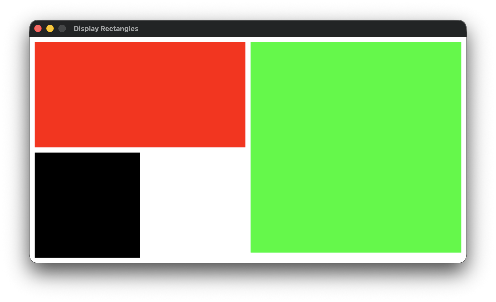

# Program Output

```
Enter Length: 400
Enter Height: 200
Rectangle 1: length 400 height 200 Area 80000
Rectangle 2: length 400 height 400 Area 160000
Rectangle 3: length 200 height 200 Area 40000
closing window
```


