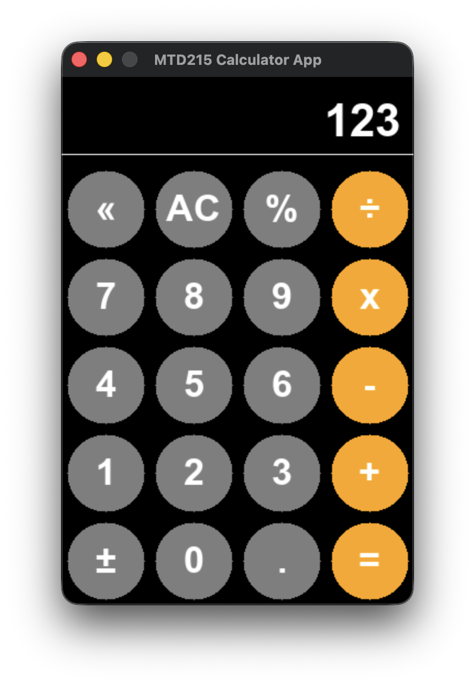

# Calculator App [Work in Progress]

## Software Architecture

The program consists of a frontend and a backend.

The backend is represented by the [Formula class](formula.h) which is responsible for:
* processing user's input
* validating the formula entered by the user
* evaluating the formula

The frontend consists of
* a [GridWindow](gridwindow.h)
    * It is a window that houses a grid of 6 rows and 4 columns
    * Individual GUI widgets such as buttons and text display are assigned to each cell in the grid.
* Text Display
    * renders the current formula on the display
*